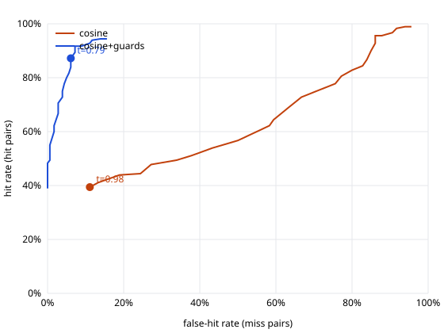

# semantic-cache

Reuses answers for semantically similar LLM requests to cut cost and latency, with a measured
false-hit rate and safe invalidation.

## The problem

"What is the refund window for EU orders?" and "...for US orders?" are almost the same vector, but
they need different answers. A semantic cache that only looks at cosine similarity serves wrong
answers. M1 measures how often, offline and reproducibly, and what cheap guards fix.

## Results (M1)

360 synthetic pairs (180 `hit`: reuse is fine, 180 `miss`: must not reuse) in 10 types, embedded
with local Ollama `nomic-embed-text`, plus 51 held-out "adversarial hits" (below). Threshold chosen
on a validation split (50/50 by pair-id hash) and reported on the test split. Intervals are Wilson
95%. Full tables, the whole sweep and per-type numbers: `bench/results.md`.

| Test split | Threshold | Hit rate (hit pairs) | False-hit rate (miss pairs) |
|---|---|---|---|
| cosine only | 0.98 (no threshold met the 5% false-hit limit) | 43.8% [34.0, 54.2] | 9.7% [5.2, 17.4] |
| cosine + guards | 0.79 | 85.4% [76.6, 91.3] | 7.5% [3.7, 14.7] |

The guards' validation false-hit rate was 4.6% (limit 5%); on the test split it is 7.5%, so the
5% target is not met out of sample. The 93 test miss pairs give a wide interval.

At the same threshold (0.79, all 360 pairs) cosine alone serves a wrong answer for 85.0% of the
`miss` pairs (negation 100%, number change 100%, personal 100%, time scope 97%, entity swap 77%,
topic_near 37%) while the guards cut that to 6.1%. The guards do nothing for `topic_near`
(related but different question): 33% still slip through, and the 3% entity-swap leaks are
countries outside the gazetteer.



### What guards cost

- On the main pair set, hit rate at equal threshold: 90.0% to 87.2% (paraphrases 81.2% to 73.9%).
  This understates the cost, because those hit pairs contain almost no numbers, dates, time words
  or negations, so there was little for the guards to misfire on (and the miss pairs were built
  from the same vocabulary the guards check, so the false-hit side is optimistic too).
- Held-out adversarial hits: 51 pairs where the answer is the same but the surface differs
  ("thirty days" vs "30 days", "last week" vs "previous week", "Q3" vs "third quarter", "can't" vs
  "unable to", dates in different formats, "v3" vs "version three", entity plurals). Caveat: three
  categories (number words, quarters, alphanumeric codes) were written in the same fix round that
  taught the guards those forms, so their 0% is by construction; the other five (time synonyms,
  date formats, entity forms, negation synonyms, version words) were written without reference to
  the guard lists. The guards wrongly deny 27.5% [17.1, 40.9] of all 51 — treat that as a lower
  bound; on the independent categories alone the rate is much higher (time synonyms 100%, date
  formats 50%, entity forms 29%, version words 20%, negation synonyms 13%). Cosine only serves 39% of them at 0.98 and the
  guards 71% at 0.79, but those thresholds differ, so this is not an apples-to-apples cost.
  Treat roughly "a few points on typical traffic, a quarter on paraphrased numbers/dates/times".
- Complexity: the gazetteer is hand-maintained.

### Limits

- Pairs are synthetic, short and written by one author; numbers will differ on real traffic.
- Miss pairs reuse the vocabulary the guards check (digits differ, negators, time words), and the
  main hit pairs hardly contain such words. The guards' benefit on the miss side and their cost on
  the hit side are both therefore only bounded, not estimated; the adversarial set measures the
  cost side separately.
- Entities outside the gazetteer are not caught (6 of 30 entity-swap pairs use unknown countries).
- Personal detection is a regex (my/mine/me/we/our, "am I", "did I", "do I have", "I'm", "I've",
  "I ordered"...). It is a heuristic: paraphrases that avoid those words are treated as shared,
  and generic prompts with "me" or "we" are treated as personal (cached per user only).
  Concretely, prompts with no first-person word still leak across users: "Is the refund approved
  yet?", "Where is order 4412?" (order ids are shared), "Why was the card declined?", and bare
  "Do I qualify for the discount?". Use per-user namespaces for account-specific endpoints.
- Numbers are compared in order ("v2 to v3" differs from "v3 to v2"), so reordered questions with
  several numbers are denied. Decimals compare numerically ("1.50" = "1.5", "0.05" differs from
  "0.5"). Codes like Q3 or MP3 are whole tokens. Date formats and month names are not normalised.
- The benchmark primes a fresh cache with a single entry per pair, so it measures pairwise
  decisions, not competition between many cached entries or real traffic.
- `InMemoryBackend` is not thread-safe.
- Stale-cache detection hashes the model name, prefix and text, not the model digest: re-pulling
  `nomic-embed-text` with different weights under the same name is not detected.
- Hit pairs are single-user; cross-user sharing of non-personal answers is assumed fine.
- Small groups (about 15 per type on the test split) give wide CIs; the thresholds were selected
  from 178 validation pairs.

## Usage

```bash
uv sync
uv run scache embed          # fill data/embeddings.npz from local Ollama (127.0.0.1:11434)
uv run scache bench          # write bench/results.{json,md} and bench/curve.svg
uv run scache bench --check  # recompute and compare with bench/results.json (tolerance 0.005)
uv run pytest && uv run ruff check .   # offline; tests never need Ollama
```

`scache embed` only embeds new or stale texts (hash of model, prefix and text); `scache bench`
refuses to run on a stale cache. Both sides use the `search_query: ` prefix.

## Layout

- `src/scache/cache.py` - `SemanticCache(backend, embedder, threshold, guards, scoper)`,
  `InMemoryBackend` (numpy brute force; interface ready for Redis in M2)
- `src/scache/guards.py` - numbers, entities, negation, time scope, personal; scoping
- `src/scache/bench.py`, `cli.py`, `embeddings.py`
- `data/pairs.yaml` (generated by `scripts/make_pairs.py`), `data/embeddings.npz`
- `plans/` - roadmap and milestone plans; `AGENTS.md` - rules for agents; `DECISIONS.md`
