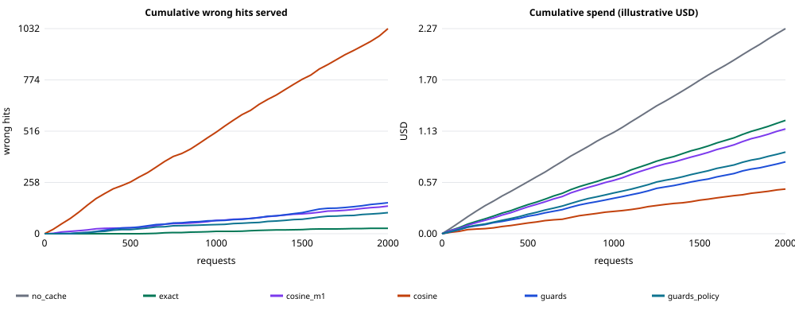

# Replay results

Synthetic traffic: 2000 requests over 6.99 days, 628 distinct prompts, 377 intents (fictional shop / SaaS support desk, fixed seed). Embeddings: `nomic-embed-text` (768 dims). Entries live 24 h on the log's clock. Thresholds come from M1 (`bench/results.json`), not from this traffic: cosine 0.98, cosine+guards 0.79. 95% CIs are block bootstrap percentiles (1000 resamples of 50-request blocks).

A hit is correct iff the cached entry's hidden intent id equals the request's. A wrong hit serves an answer to a different question. All dollar and latency figures use an **illustrative** price and latency model (below), not a real provider's.

## Headline

| Variant | Hit rate % | Correct hits | Wrong hits | Wrong per 1,000 requests | Cross-user leaks |
|---|---|---|---|---|---|
| no cache | 0.0 [0.0, 0.0] | 0 | 0 | 0.0 [0.0, 0.0] | 0 |
| exact match only | 41.6 [40.0, 43.4] | 806 | 27 | 13.5 [9.0, 18.5] | 0 |
| cosine only, M1 threshold 0.98 | 46.5 [44.7, 48.3] | 790 | 139 | 69.5 [59.5, 80.5] | 99 |
| cosine only, threshold 0.79 | 76.8 [75.0, 78.6] | 503 | 1032 | 516.0 [487.0, 544.5] | 111 |
| cosine + guards, threshold 0.79 | 62.9 [61.0, 64.9] | 1103 | 156 | 78.0 [64.0, 92.0] | 0 |
| cosine + guards + never-cache policy, threshold 0.79 | 58.1 [56.2, 60.1] | 1056 | 106 | 53.0 [43.5, 64.5] | 0 |

## Cost and latency (illustrative model)

Price table (illustrative): input $1.00 and output $4.00 per million tokens. No-cache spend: $2.27. Latency model: embedding 25 ms per lookup, generation 300 ms + 12 ms per output token (no-cache mean 3309 ms). "Saved" counts every avoided model call, including calls whose wrong answer was served; "saved by correct hits" counts only correct ones.

| Variant | Model calls | Calls saved | Cost saved % | Saved by correct hits % | Mean latency ms |
|---|---|---|---|---|---|
| no cache | 2000 | 0 | 0.0 [0.0, 0.0] | 0.0 [0.0, 0.0] | 3309 [3239, 3375] |
| exact match only | 1167 | 833 | 44.7 [42.7, 46.8] | 43.4 [41.4, 45.4] | 1826 [1756, 1896] |
| cosine only, M1 threshold 0.98 | 1071 | 929 | 48.9 [46.6, 51.2] | 42.8 [40.8, 44.9] | 1712 [1639, 1789] |
| cosine only, threshold 0.79 | 465 | 1535 | 78.2 [76.3, 80.1] | 25.1 [22.6, 27.5] | 745 [680, 806] |
| cosine + guards, threshold 0.79 | 741 | 1259 | 65.0 [62.9, 67.0] | 57.6 [55.3, 60.1] | 1182 [1113, 1252] |
| cosine + guards + never-cache policy, threshold 0.79 | 838 | 1162 | 60.2 [58.1, 62.3] | 55.3 [53.1, 57.7] | 1339 [1272, 1407] |

## Wrong hits by request type

Type is the request kind, except `personal_leak` (a personal answer cached for another user) and `stale` (a time-sensitive answer from an earlier day, served within the TTL).

| Type | no cache | exact match only | cosine only, M1 threshold 0.98 | cosine only, threshold 0.79 | cosine + guards, threshold 0.79 | cosine + guards + never-cache policy, threshold 0.79 |
|---|---|---|---|---|---|---|
| exact_repeat | 0 | 0 | 5 | 451 | 14 | 14 |
| first_seen | 0 | 0 | 0 | 28 | 5 | 5 |
| near_miss_entity | 0 | 0 | 0 | 61 | 6 | 6 |
| near_miss_negation | 0 | 0 | 0 | 24 | 0 | 0 |
| near_miss_number | 0 | 0 | 5 | 63 | 0 | 0 |
| near_miss_time | 0 | 0 | 0 | 57 | 0 | 0 |
| paraphrase | 0 | 0 | 1 | 111 | 8 | 8 |
| personal_leak | 0 | 0 | 99 | 111 | 0 | 0 |
| stale | 0 | 27 | 27 | 44 | 37 | 0 |
| time_sensitive | 0 | 0 | 0 | 9 | 13 | 0 |
| unique | 0 | 0 | 2 | 73 | 73 | 73 |

## Request mix

| Kind | Requests |
|---|---|
| exact_repeat | 780 |
| first_seen | 85 |
| near_miss_entity | 76 |
| near_miss_negation | 80 |
| near_miss_number | 97 |
| near_miss_time | 78 |
| paraphrase | 274 |
| personal | 185 |
| time_sensitive | 138 |
| unique | 207 |

## Measured lookup time (this machine)

Time of `SemanticCache.get` (vector search over the in-memory backend plus guards) with embeddings read from the cache, so it excludes the embedding call. It varies from run to run and is not part of `--check`.

| Variant | Median us | p95 us |
|---|---|---|
| exact match only | 2 | 3 |
| cosine only, M1 threshold 0.98 | 286 | 341 |
| cosine only, threshold 0.79 | 240 | 336 |
| cosine + guards, threshold 0.79 | 364 | 631 |
| cosine + guards + never-cache policy, threshold 0.79 | 361 | 644 |

