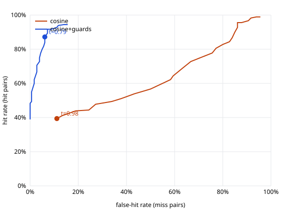

# Benchmark results

Embedding model `nomic-embed-text` (768 dims), 360 pairs (180 hit / 180 miss). Threshold chosen on the validation split (178 pairs, split by pair-id hash), reported on the test split (182 pairs). Wilson 95% CIs.

## Chosen thresholds

Rule: highest hit rate on validation with false-hit rate <= max (max 5.0%).

| Mode | Threshold | Feasible | Val hit rate | Val false-hit rate |
|---|---|---|---|---|
| cosine | 0.98 | no | 35.2% | 12.6% |
| cosine+guards | 0.79 | yes | 89.0% | 4.6% |

## Test split at the chosen thresholds

Hit rate on `hit` pairs (higher is better), false-hit rate on `miss` pairs (lower is better). Each mode uses its own chosen threshold.

| Group | Kind | n | cosine only | cosine + guards |
|---|---|---|---|---|
| ALL hit pairs | hit rate | 89 | 43.8% [34.0%, 54.2%] | 85.4% [76.6%, 91.3%] |
| ALL miss pairs | false-hit rate | 93 | 9.7% [5.2%, 17.4%] | 7.5% [3.7%, 14.7%] |
| case | hit rate | 17 | 100.0% [81.6%, 100.0%] | 100.0% [81.6%, 100.0%] |
| entity_swap | false-hit rate | 17 | 0.0% [0.0%, 18.4%] | 5.9% [1.0%, 27.0%] |
| negation | false-hit rate | 15 | 33.3% [15.2%, 58.3%] | 0.0% [0.0%, 20.4%] |
| number_change | false-hit rate | 14 | 0.0% [0.0%, 21.5%] | 0.0% [0.0%, 21.5%] |
| paraphrase | hit rate | 33 | 6.1% [1.7%, 19.6%] | 72.7% [55.8%, 84.9%] |
| personal | false-hit rate | 14 | 14.3% [4.0%, 39.9%] | 0.0% [0.0%, 21.5%] |
| reorder | hit rate | 21 | 95.2% [77.3%, 99.2%] | 100.0% [84.5%, 100.0%] |
| time_scope | false-hit rate | 16 | 12.5% [3.5%, 36.0%] | 0.0% [0.0%, 19.4%] |
| topic_near | false-hit rate | 17 | 0.0% [0.0%, 18.4%] | 35.3% [17.3%, 58.7%] |
| typo | hit rate | 18 | 0.0% [0.0%, 17.6%] | 77.8% [54.8%, 91.0%] |

## Same threshold (0.79), all pairs: what the guards buy and cost

| Group | Kind | cosine only | cosine + guards |
|---|---|---|---|
| ALL hit pairs | hit rate | 90.0% | 87.2% |
| ALL miss pairs | false-hit rate | 85.0% | 6.1% |
| case | hit rate | 100.0% | 100.0% |
| entity_swap | false-hit rate | 76.7% | 3.3% |
| negation | false-hit rate | 100.0% | 0.0% |
| number_change | false-hit rate | 100.0% | 0.0% |
| paraphrase | hit rate | 81.2% | 73.9% |
| personal | false-hit rate | 100.0% | 0.0% |
| reorder | hit rate | 100.0% | 100.0% |
| time_scope | false-hit rate | 96.7% | 0.0% |
| topic_near | false-hit rate | 36.7% | 33.3% |
| typo | hit rate | 87.5% | 87.5% |

## Adversarial hits: where the guards misfire

51 extra `hit` pairs written independently of the guard vocabulary (number words, version words, quarters, date formats, time and negation synonyms, entity plurals, alphanumeric codes). They are not part of the sweep or the threshold selection. Guard false-deny rate (guards refuse a reuse that is fine): 27.5% [17.1%, 40.9%]. Denied by: {'numbers_guard': 4, 'time_scope_guard': 7, 'scoper': 1, 'entity_guard': 2}.

| Category | n | Guard false-deny rate |
|---|---|---|
| alnum_codes | 3 | 0.0% [0.0%, 56.2%] |
| date_format | 6 | 50.0% [18.8%, 81.2%] |
| entity_forms | 7 | 28.6% [8.2%, 64.1%] |
| negation_synonym | 8 | 12.5% [2.2%, 47.1%] |
| number_words | 10 | 0.0% [0.0%, 27.8%] |
| quarter | 5 | 0.0% [0.0%, 43.4%] |
| time_synonym | 7 | 100.0% [64.6%, 100.0%] |
| version_words | 5 | 20.0% [3.6%, 62.4%] |

| Mode | Threshold | Hit rate on adversarial hits |
|---|---|---|
| cosine | 0.98 | 39.2% [27.0%, 52.9%] |
| cosine+guards | 0.79 | 70.6% [57.0%, 81.3%] |

## Threshold sweep, all pairs

| Threshold | Hit rate (cosine) | False-hit rate (cosine) | Hit rate (+guards) | False-hit rate (+guards) |
|---|---|---|---|---|
| 0.70 | 98.9% | 95.6% | 94.4% | 15.6% |
| 0.71 | 98.9% | 95.6% | 94.4% | 15.6% |
| 0.72 | 98.9% | 94.4% | 94.4% | 14.4% |
| 0.73 | 98.9% | 93.9% | 94.4% | 13.9% |
| 0.74 | 98.3% | 91.7% | 93.9% | 11.7% |
| 0.75 | 96.7% | 90.6% | 92.8% | 11.1% |
| 0.76 | 95.6% | 87.8% | 91.7% | 8.9% |
| 0.77 | 95.6% | 86.1% | 91.7% | 7.2% |
| 0.78 | 92.8% | 86.1% | 89.4% | 7.2% |
| 0.79 | 90.0% | 85.0% | 87.2% | 6.1% |
| 0.80 | 86.7% | 83.9% | 83.9% | 6.1% |
| 0.81 | 84.4% | 82.8% | 81.7% | 5.6% |
| 0.82 | 82.8% | 80.0% | 80.0% | 5.0% |
| 0.83 | 80.6% | 77.2% | 77.8% | 4.4% |
| 0.84 | 77.8% | 75.6% | 75.0% | 3.9% |
| 0.85 | 75.0% | 70.6% | 72.8% | 3.9% |
| 0.86 | 72.8% | 66.7% | 70.6% | 2.8% |
| 0.87 | 68.9% | 63.3% | 66.7% | 2.8% |
| 0.88 | 64.4% | 59.4% | 62.2% | 1.7% |
| 0.89 | 62.2% | 58.3% | 60.0% | 1.7% |
| 0.90 | 56.7% | 50.0% | 55.0% | 0.6% |
| 0.91 | 53.9% | 43.3% | 52.2% | 0.6% |
| 0.92 | 51.1% | 37.8% | 49.4% | 0.6% |
| 0.93 | 49.4% | 33.9% | 48.3% | 0.0% |
| 0.94 | 47.8% | 27.2% | 47.2% | 0.0% |
| 0.95 | 44.4% | 24.4% | 43.9% | 0.0% |
| 0.96 | 43.9% | 18.9% | 43.3% | 0.0% |
| 0.97 | 41.1% | 13.3% | 40.6% | 0.0% |
| 0.98 | 39.4% | 11.1% | 38.9% | 0.0% |

